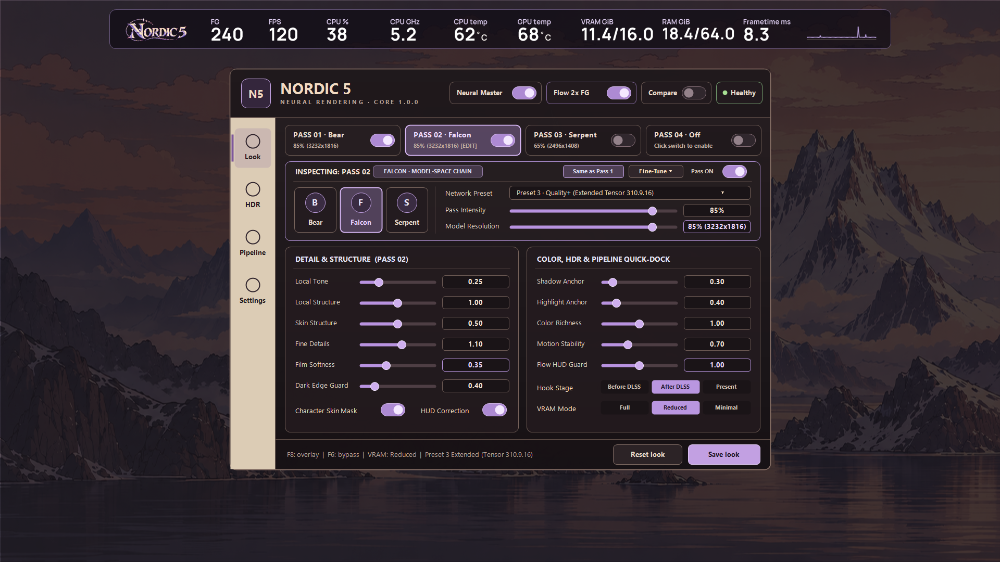
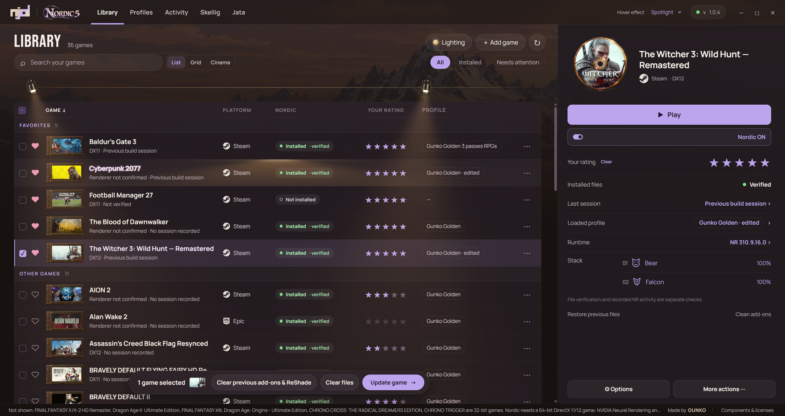
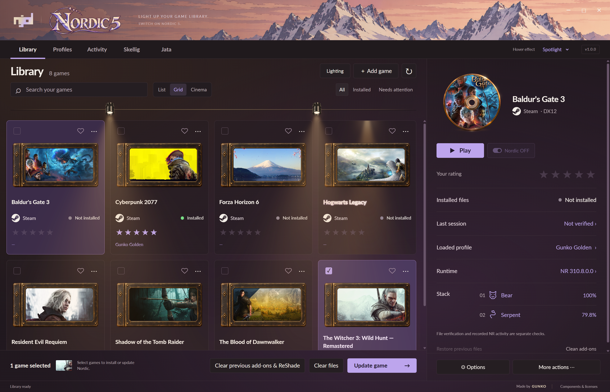
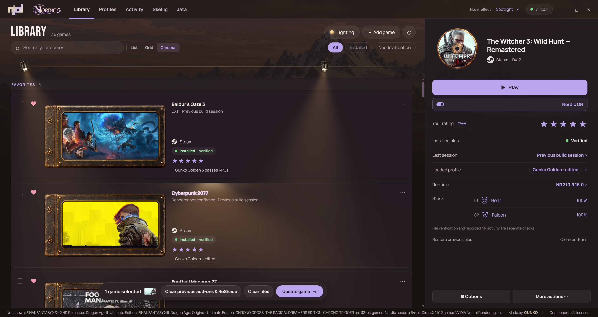
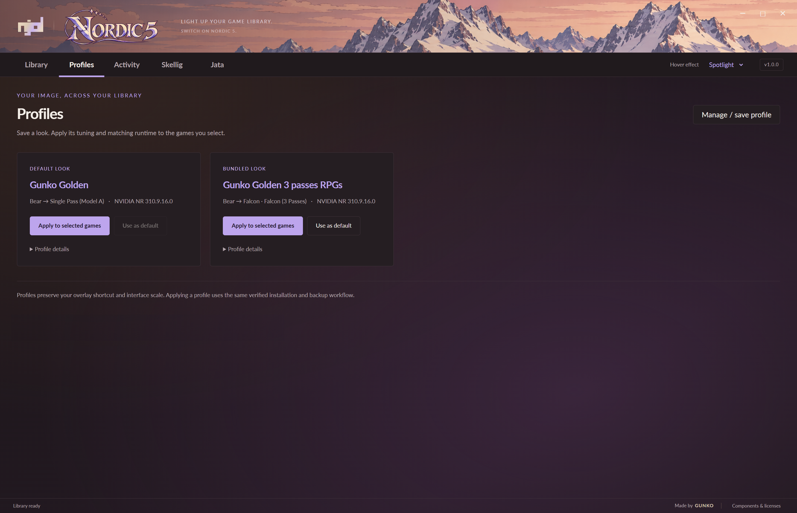
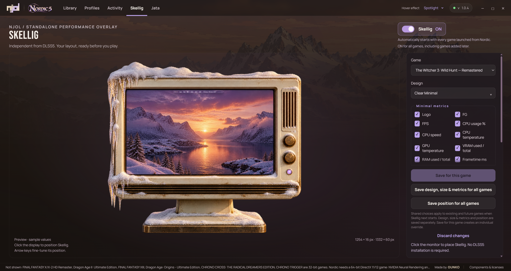
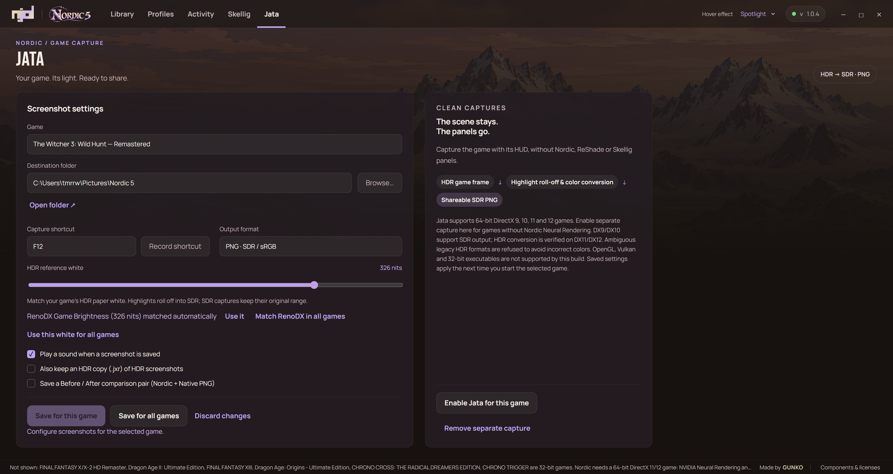

# NORDIC 5

[Download for Windows (`NordicDLSS5.exe`)](https://github.com/gunkobaek/NORDIC-DLSS5/releases/download/v1.0.0/NordicDLSS5.exe) | [Latest Release (`v1.0.0`)](https://github.com/gunkobaek/NORDIC-DLSS5/releases/tag/v1.0.0)

**Launcher 1.0.0 / Add-on Core 1.0.0**

Light up your game library. Nordic brings up to four independently tuned NVIDIA NR passes, multi-scale local relighting, saved looks and per-game controls to a warm, resizable game launcher and in-game Frost Studio overlay.

## In-Game Add-on & Launcher Preview

### In-Game Frost Studio Add-on (`\` / `F8`) & Skellig Performance HUD (`VRAM GiB`)

### Launcher — Library List View & Selected Game Stage

| Library — Grid View | Library — Cinema View |
| :---: | :---: |
|  |  |

### Profiles, Skellig Performance Monitor & Jata HDR → SDR Capture

| Saved Looks & Multi-Pass Profiles | Skellig Performance Overlay Designer |
| :---: | :---: |
|  |  |

## What's new in 1.0.0 & recent releases

**Multi-pass neural rendering & multi-scale local relighting (`v1.0.0`).** Chain up to four independent neural passes (Bear, Falcon, Serpent) with per-pass Intensity, Transfer, Follow Pass 1, Network Preset (`Preset 1 Classic`, `Preset 2 Performance`, `Preset 3 Quality+ Extended`) and Resolution Scale, paired with multi-scale local tone relighting (`0.00–2.00`), Film Softness (`0.00–1.00`), Cinema/Natural HDR highlight protection, a 31-axis Model Lab in Frost Studio, built-in DirectX 11-to-DirectX 12 GPU bridge and Nordic Flow 2x Frame Generation. [Full v1.0.0 release notes](https://github.com/gunkobaek/NORDIC-DLSS5/releases/tag/v1.0.0).

**Live GPU VRAM (`VRAM GiB`) in Skellig & Unreal Engine 5 fixes.** Skellig's `Clear Minimal` overlay now includes real-time GPU VRAM usage (`used/total GiB` via NVML) alongside FG, FPS, CPU %, CPU GHz, CPU/GPU temperature, system RAM and frametime graph. `Skellig.addon64` stays registered across Unreal Engine 5's temporary DirectX 12 startup probes (fixing missing overlays in games such as *Clair Obscur: Expedition 33*), dynamically reloads target executables and preferences from `session.ini`, and transitions cleanly when `Skellig.exe` runs with administrator permissions for CPU temperature sensors.

**Automatic HDR reference white & screenshots you can hear.** Jata confirms every shot in game with a small "Screenshot saved" note, which never appears in the image, and an optional kantele sound. It now automatically detects and applies RenoDX's *Game Brightness* (`ToneMapGameNits`) in real time on every capture (or matches your Windows HDR display calibration), and can save an optional lossless HDR copy (`.jxr`) next to each PNG.

**Safer updates & library polish.** Nordic asks before updating your games, and *Keep this game on its current Nordic version* stops automatic updates for that game. Library Snow hover banks stay intact across star rating updates. Only one Nordic window runs at a time, and later updates no longer restyle your `ReShade.ini`.

**Under the hood:** smoother neural rebuilds when the resolution changes; logs now show rebuild time, video memory and whether real DLSS depth and motion are used; crash reports are clearer; 32-bit games are reported instead of skipped silently.

## Architecture & File Transparency

Nordic 5 is a self-contained Windows desktop launcher (`NordicDLSS5.exe`) and ReShade Add-on suite (`Gunko.addon64`, `Skellig.addon64`, `Jata.addon64`). It makes **zero background network connections** outside explicit GitHub release update checks and modifies **only** the game directories you explicitly select:

- **`Gunko.addon64` & `Gunko/Gunko.nvngx.dll`**: Intercepts native DLSS inputs (`Color`, `Depth`, `MotionVectors`, `Exposure`) and dispatches the user-supplied signed NVIDIA `nvngx_dlssnr.dll` runtime on DirectX 12 (or via the shared-handle D3D11-to-D3D12 bridge for DirectX 11 games).
- **`Skellig.exe` & `Skellig.addon64`**: Independent hardware-accelerated telemetry overlay powered by Intel PresentMon (MIT) and NVML (`nvml.dll`).
- **`Jata.addon64`**: Clean post-ReShade, pre-UI screenshot capture with PQ/scRGB HDR-to-SDR tone mapping and automatic RenoDX `ToneMapGameNits` detection.
- **Reproducible & Verifiable Release Digests (`v1.0.0`)**:
  - `NordicDLSS5.exe` SHA-256: `a29eaef041002f0d00e1352c78f0f698616d5b5f388e032177b6b1047cc68c45`
  - `Gunko.addon64` SHA-256: `0f4e37c2d0681f92a35cf7c9c20f9e5365ef2c896d6b0ff9c3e5a3102d1ef8b8`

## Jata capture (since 0.5.84)

**Jata now supports 64-bit DirectX 9/9Ex, 10/10.1, 11 and 12 games.** Capture the final game image after ReShade effects, without Nordic, ReShade or Skellig panels. The game's own HUD remains. DX11/DX12 HDR scenes are tone-mapped into shareable SDR/sRGB PNGs; DX9/DX10 SDR captures preserve the scene's original colors.

Use **Jata → Enable Jata for this game** for a compatible game without Neural Rendering. The separate capture component does not require an NVIDIA NR runtime. Choose your shortcut, destination folder and HDR reference white; save for one game or all games. Restart the game after installing or updating its addon.

**Scope:** 64-bit executables only; no x86, OpenGL or Vulkan. DX9/DX10 support SDR output, while ambiguous legacy HDR formats are refused. DX9 capture may cause a brief readback hitch at the moment of the shot. Neural Rendering and Skellig's fullscreen renderer retain their own DX11/DX12 requirements. Tested with real DirectX/ReShade fixtures; compatibility is not universal. [Full release notes](https://github.com/gunkobaek/NORDIC-DLSS5/releases/tag/v0.7.32-beta.1).

The release retains integrated CPU temperature, transparent and FPS-only Skellig layouts, the compact graph beside frametime, and the Clair Obscur and repeated neural ON/OFF stability fixes. Personal profiles and tuning are preserved.

## Skellig performance monitor

Skellig runs as a separate app managed from its own launcher tab. Choose Nocturne Strip, Atelier, Instrument, Strip Minimal, Clear Minimal or FPS Only. Clear Minimal has no background and can show a small frametime graph immediately beside the millisecond value. Choose individual metrics including CPU usage, clock, temperature, GPU temperature, **GPU VRAM (`VRAM GiB`)** and system RAM usage. Save design, size and metrics for all games, with position saved separately; individual overrides remain available.

The global ON switch persists and starts Skellig with games launched through Nordic. F9 toggles visibility for the current session. Supports windowed, borderless and exclusive fullscreen in DirectX 11/12. Restart after first enabling fullscreen support or updating its renderer. Layout changes apply at the next Skellig start.

FG measures displayed frames, including generated frames when reported. FPS measures application frames before generation, including with Super Resolution enabled. AVG and the graph use application frames. Unavailable telemetry shows N/D, not a guessed FG multiplier.

CPU temperature is integrated through a bundled CPU-only sensor companion and signed PawnIO driver; no separate monitoring app is needed. Windows permission and occasionally a restart may be required for setup. Sensor availability depends on supported hardware; unavailable readings show N/D.

## Nordic and ReShade shortcuts

INS opens the full ReShade interface. Open Nordic with backslash, its F10 keyboard-layout fallback, or your chosen keybind. Options > Global Nordic Shortcut applies one key to all installed Nordic games and saves the default for new installations. Individual game overrides remain available. Restart running games after changing their shortcut.

## Your library, in a new light

NJOL brown and lavender, a snowy mountain banner, Lato text, Steam icons, Collector artwork and a DVD-style selected-game display. Choose List, Grid or Cinema, save favorites and rate games in half-star steps.

Two warm spotlights sit above the library. Drag horizontally to slide them or diagonally down to aim; the mounts stay on the rail. Lighting > Arrange & aim provides handles, while Power and Drama shape the scene. Spotlight, Cinema and Snow add motion to buttons. Placement, lighting and preferences are saved.

Nordic ON/OFF beside Play controls whether the add-on loads before starting a game. Saved tuning remains available when it is OFF. Profiles, backup/Restore, add-on cleanup and update prompts are built into the launcher.

## Update the launcher and games

Accept Update now in the installed launcher, use Check for updates now, or download and run NordicDLSS5.exe. Keep Nordic open to automatically update add-ons in already installed games. Running games wait until they close. Automatic game updates are enabled by default; a previously saved opt-out is respected. You can also select games and choose Update selected, or use Update all installed game add-ons. Existing profiles, tuning and interface preferences are preserved.

## Render Presets (1, 2 & 3) with the 310.9.16.0 DLL

The current NVIDIA NR `310.9.16.0` DLL supports three **Network Presets**, independent of the Bear, Falcon and Serpent style models:
- **Preset 1 (`Quality / Classic`)**: Runs the legacy `310.8.0` neural graph included for backward compatibility. Uses more GPU compute time (~6.5 ms/pass at 4K 85%).
- **Preset 2 (`Performance / Fast`)**: Runs the newer `310.9.16` Tensor architecture in fast mode.
- **Preset 3 (`Quality+ / Extended`)**: Runs the newer `310.9.16` hardware-fused Tensor architecture with extended refinement blocks—delivering high spatial/temporal quality at nearly **2× the speed** of Preset 1 (~3.4 ms/pass at 4K 85%).

Open Profiles, choose **Gunko_Golden** and Apply to selected games. Applying a profile replaces tuning and creates a backup. The older signed 310.8.0.0 runtime remains available as a separate choice.

Locate your own compatible nvngx_dlssnr.dll in the launcher. No NVIDIA runtime is included or downloaded. Nordic preserves each game's own DLSS SR, Ray Reconstruction, Frame Generation and Streamline DLLs. Restart the game after updating or switching runtime.

## In game and recovery

Backslash opens Nordic; F10 is the keyboard-layout fallback. Escape closes it. F6 toggles processing and F7 compares the image. Set a custom shortcut in Options and restart the game.

Rendered, Upscaled and Present choose where Nordic applies. With Frame Generation active, Present uses the before-FG compatibility route. Healthy means recent NR processing is completing. Waiting, Disabled, Bypassed and GPU error have their own status.

Clean add-ons previews the exact files and saves a backup. Restore recovers the previous files. Games must be closed for updates, cleanup and restoration. Unknown proxy mods and unrelated game files are retained.

## Requirements and feedback

Windows 10/11 x64, .NET Framework 4.8, Microsoft Edge WebView2 Runtime and a compatible NVIDIA NR runtime. Neural Rendering needs native DLSS inputs and a supported DirectX 11 or DirectX 12 executable. Separate Jata capture supports 64-bit DX9/10 SDR and DX11/12 SDR/HDR without requiring the NVIDIA NR runtime. BG3 requires bg3_dx11.exe; Vulkan is unsupported. Compatibility varies by game and GPU.

Report problems through [GitHub Issues](https://github.com/gunkobaek/NORDIC-DLSS5/issues) or your existing tester thread. Include the game, build, GPU/driver and steps to reproduce. Diagnostics exports a support bundle locally; review it before sharing. Nothing is uploaded automatically.

[Made by GUNKO](https://gunko.com/)
